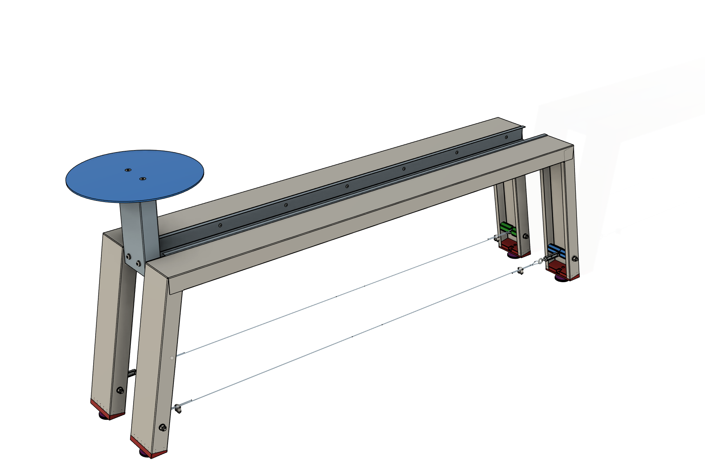

# Banca 1 · BIBA 2026

Una banca hecha con **una sola tira de Metalcon de 6 m**. Se dobla, se remacha y se tensa con un cable de pata a pata. Sin soldadura.

Proyecto de [@form4tic](https://instagram.com/form4tic) y [@asociativo_](https://instagram.com/asociativo_) para la **3ª Bienal de Bancas (BIBA 2026)**.

> Exhibición: sábado 21 de noviembre de 2026, Coyancura 2223, Providencia, de 15:30 a 19:00.

## La idea

En 1974 Enzo Mari publicó *Autoprogettazione*: muebles que cualquiera puede construir con materiales comunes y herramientas básicas. Mari mandaba sus planos por correo con una sola condición: cualquiera podía usarlos para hacer sus propios muebles, salvo industrias y comerciantes.

Nos preguntamos cómo se reinterpreta ese manifiesto hoy y qué alternativa existe a la madera en bruto. Elegimos el perfil de acero galvanizado (Metalcon): estandarizado, accesible y con el que se levantan miles de casas. El resultado es una banca open source que se puede personalizar, con el diseño libre para las personas y cerrado al comercio.

## Qué hay en este repositorio

| Carpeta | Contenido |
|---|---|
| [`planos/`](planos/) | Modelo 3D final V02 (STEP y Fusion .f3d) y vistas |
| [`piezas/`](piezas/) | Lista de piezas y materiales |
| [`instructivo/`](instructivo/) | Paso a paso de construcción |
| [`variaciones/`](variaciones/) | Versiones de la banca y cómo aportar la tuya |
| [`impresion-3d/`](impresion-3d/) | STL de las piezas impresas |
| [`fotos/`](fotos/) | Proceso de taller |

## Resumen de piezas (V02)

Medidas generales: 139,8 × 29,9 × 59,8 cm (largo × profundidad × alto, incluida la mesa).

| ITEM | GRUPO O SUBCONJUNTO | PART NUMBER | DESCRIPCIÓN | MATERIAL | STOCK | PROCESO | CANTIDAD |
|---|---|---|---|---|---|---|---|
| 1 | SUBCONJUNTO PATA | BIBA_001_V02 | MÓDULO PATA | ACERO GALVANIZADO (METALCON E=0,85 MM) | FABRICACIÓN | CORTE Y PLEGADO | 2 |
| 2 | SUBCONJUNTO PATA | BIBA_006_V04 | ACCESORIO TERMINAL | PLA | FABRICACIÓN | IMPRESIÓN 3D | 4 |
| 3 | SUBCONJUNTO PATA | BIBA_007_V01 | PIEZA 007 (DESCRIPCIÓN PENDIENTE) | PLA | FABRICACIÓN | IMPRESIÓN 3D | 4 |
| 4 | SUBCONJUNTO PATA | BIBA_008_V01 | PIEZA 008 (DESCRIPCIÓN PENDIENTE) | PLA | FABRICACIÓN | IMPRESIÓN 3D | 2 |
| 5 | SUBCONJUNTO PATA | BIBA_010_V01 | PATÍN AJUSTE DE ALTURA | PLA | FABRICACIÓN | IMPRESIÓN 3D | 6 |
| 6 | SUBCONJUNTO PATA | CABLE ACERO GALV_2MM_B | Cable acero galv. 2 mm x 650 mm | ACERO GALVANIZADO | COMERCIAL | TREFILADO | 4 |
| 7 | SUBCONJUNTO PATA | HILO CORRIDO G2 1/4 | Hilo corrido G2 1/4" x 115 mm | ACERO | COMERCIAL | LAMINADO DE ROSCA | 4 |
| 8 | SUBCONJUNTO PATA | TENSOR OJO-OJO_3/16 | Tensor ojo/ojo ac zc 3/16x6 3/8" | ACERO GALVANIZADO | COMERCIAL | FUNDICIÓN | 2 |
| 9 | SUBCONJUNTO PATA | ABRAZADERA CAB 1/8 | Abrazadera para cable 1/8" ac zc | ACERO GALVANIZADO | COMERCIAL | FORJADO | 4 |
| 10 | SUBCONJUNTO PATA | M6 CON SEGURO DE NYLON | Tuerca M6 c/seguro nylon inox | ACERO INOXIDABLE | COMERCIAL | FORJADO EN FRÍO | 4 |
| 11 | SUBCONJUNTO PATA | M6x20 CAB BOTON PARKER | Perno M6x20 cab. botón allen inox | ACERO INOXIDABLE | COMERCIAL | FORJADO EN FRÍO | 6 |
| 12 | SUBCONJUNTO PATA | 1/4_20 THREAD SIZE | Tuerca 1/4"-20 c/seguro nylon inox | ACERO INOXIDABLE | COMERCIAL | FORJADO EN FRÍO | 8 |
| 13 | SUBCONJUNTO PATA | 0.250 ID X 0.562 OD (1/4) | Golilla plana 1/4" ac | ACERO | COMERCIAL | ESTAMPADO | 8 |
| 14 | SUBCONJUNTO ACCESORIOS | BIBA_002_V02 | MÓDULO ACCESORIOS | ACERO GALVANIZADO (METALCON E=0,85 MM) | FABRICACIÓN | CORTE Y PLEGADO | 1 |
| 15 | SUBCONJUNTO ACCESORIOS | BIBA_003_V02 | CUBIERTA MESA Ø275 MM E=3 MM | ALUMINIO 6061 | FABRICACIÓN | CORTE CNC Y PERFORADO | 1 |
| 16 | SUBCONJUNTO ACCESORIOS | BIBA_004_V02 | VÍNCULO CUBIERTA | PLA | FABRICACIÓN | IMPRESIÓN 3D | 1 |
| 17 | SUBCONJUNTO ACCESORIOS | BIBA_009_V01 | VÍNCULO CUBIERTA | PLA | FABRICACIÓN | IMPRESIÓN 3D | 1 |
| 18 | SUBCONJUNTO ACCESORIOS | FLAT M6 X 25_INOXIDABLE | Perno M6x25 cab. plana allen inox | ACERO INOXIDABLE | COMERCIAL | FORJADO EN FRÍO | 2 |
| 19 | SUBCONJUNTO ACCESORIOS | M6x20 CAB BOTON PARKER | Perno M6x20 cab. botón allen inox | ACERO INOXIDABLE | COMERCIAL | FORJADO EN FRÍO | 4 |
| 20 | SUBCONJUNTO ACCESORIOS | M6 CON SEGURO DE NYLON | Tuerca M6 c/seguro nylon inox | ACERO INOXIDABLE | COMERCIAL | FORJADO EN FRÍO | 6 |
| 21 | SUBCONJUNTO ACCESORIOS | GOLILLA X M6 ID6.4 OD12 | Golilla plana M6 inox | ACERO INOXIDABLE | COMERCIAL | ESTAMPADO | 4 |
| 22 | ENSAMBLE GENERAL | 97447A806_4x1.5-3 | Remache pop alum. 4x10 mm | ALUMINIO | COMERCIAL | FORJADO EN FRÍO | 14 |

Misma lista, con hojas por subconjunto, en [`piezas/lista-de-partes_V02.xlsx`](piezas/lista-de-partes_V02.xlsx) (también en [CSV](piezas/lista-de-piezas.csv)).

## Si la construyes

Mándanos una foto o abre un *issue* con tu versión. Las variaciones son bienvenidas por *pull request* en [`variaciones/`](variaciones/).

## Licencia

[CC BY-NC-SA 4.0](LICENSE). Puedes copiar, construir, modificar y compartir esta banca citando a Form4tic + Asociativo, siempre que no sea con fines comerciales y que tus variaciones usen la misma licencia.
