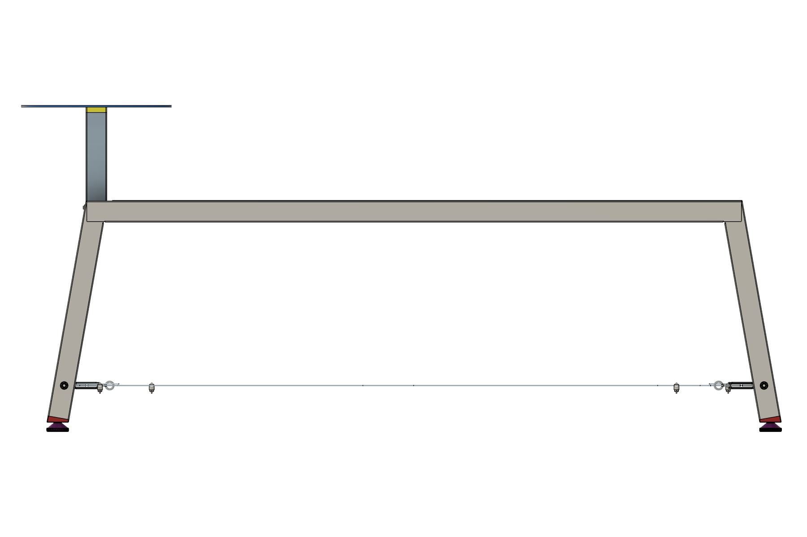

# Planos

Modelo final **V02** (`BIBA__V02`), exportado desde Fusion.

| Archivo | Para qué |
|---|---|
| [`banca-1_V02.step`](banca-1_V02.step) | Ensamble completo en formato neutro (Rhino, FreeCAD, SolidWorks, etc.) |
| [`banca-1_V02.f3d`](banca-1_V02.f3d) | Archivo nativo de Fusion con historial |
| [`vistas/`](vistas/) | Vistas iso, frontal, lateral y planta |

Medidas generales: 139,8 × 29,9 × 59,8 cm (largo × profundidad × alto, incluida la mesa).

